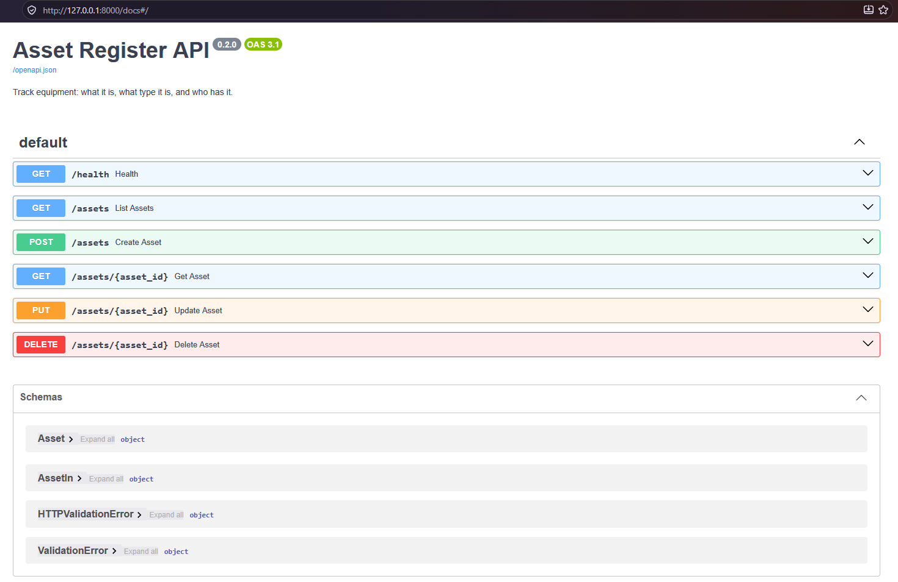

# Lab 02: First FastAPI App

## Overview

| | |
|---|---|
| **Goal** | Rebuild the Asset Register as a REST API with FastAPI, using the same fields as the original Flask app, with validation, proper error codes, interactive docs and tests |
| **Runs on** | Windows, Python 3.14, FastAPI 0.149.0, in a virtual environment |
| **Cost** | Free |
| **Time** | About two hours |

The original [Docker Asset Register](https://github.com/iM-MQ/docker-asset-register) is a Flask web page backed by PostgreSQL. This lab rebuilds it as an **API**: a service that other programs call with HTTP requests and JSON. The data is held in memory for now, so the lab can focus on FastAPI itself. Lab 03 moves it into PostgreSQL.

FastAPI generated these interactive docs from my code, without any extra work:



---

## The same data, rebuilt

I kept exactly the fields from the original app's table:

```sql
CREATE TABLE IF NOT EXISTS assets (
    id SERIAL PRIMARY KEY,
    name TEXT NOT NULL,
    type TEXT NOT NULL,
    assigned_to TEXT,
    added TIMESTAMP DEFAULT now()
)
```

What changed is everything around them:

| | Original Flask app | FastAPI rebuild |
|---|---|---|
| **Fields** | `id`, `name`, `type`, `assigned_to`, `added` | The same five |
| **Who sets `id` and `added`** | The database | The server. A client cannot choose them |
| **Operations** | List, add, delete | List, add, delete, plus get one and update |
| **Validation** | `NOT NULL` only, so a name of only spaces is accepted | Blank and over-long values are rejected with a clear error |
| **An unassigned asset** | Stored as an empty string `""` | Stored as `null`, meaning "no value" |
| **Errors** | An HTML page, or a crash | Status codes: `404 Not Found` and `422 Unprocessable Content` |
| **Documentation** | None | Interactive docs, generated from the code |
| **Tests** | None | 19, written alongside the code |

---

## Following along?

- I ran every command in **PowerShell** on Windows, using the terminal inside **VS Code**.
- Each command is in its own box. Run **one line at a time**.
- Boxes marked **What I saw** show my output. They are not commands to run.
- Follow the [first-time setup](../README.md#first-time-setup) in the main README to create and activate the virtual environment, then install this lab's packages:

```powershell
python -m pip install -r lab-02-fastapi\requirements.txt
```

---

## Files in this lab

| File | What it does |
|---|---|
| `main.py` | The API: two Pydantic models, an in-memory store and six routes |
| `test_main.py` | 15 test functions, which run as 19 tests |
| `requirements.txt` | The exact versions of FastAPI and pytest |

### The models, from `main.py`

```python
class AssetIn(BaseModel):
    """What a client sends. The same three fields as the original Flask form."""

    # Trims spaces, so "  laptop " is stored as "laptop" and "   " counts as empty
    model_config = ConfigDict(str_strip_whitespace=True)

    name: str = Field(min_length=1, max_length=100, examples=["Dell Latitude 7450"])
    type: str = Field(min_length=1, max_length=50, examples=["laptop"])
    assigned_to: str | None = Field(default=None, max_length=100, examples=["Finance team"])


class Asset(AssetIn):
    """What the API returns: the client's fields plus the two the server sets."""

    id: int
    added: datetime
```

| Code | What it does |
|---|---|
| `class AssetIn(BaseModel)` | A Pydantic model. FastAPI checks every request body against it before my code runs |
| `Field(min_length=1, max_length=100)` | Validation rules. A request that breaks one is rejected with a `422` |
| `str_strip_whitespace=True` | Trims spaces first, so a name of only spaces fails `min_length=1` |
| `examples=[...]` | Pre-fills the request body in the interactive docs |
| `class Asset(AssetIn)` | Inherits the three client fields and adds `id` and `added`, which only the server sets |

Two models mean a client can never set `id` or `added`. Any extra fields in a request, such as `"id": 999`, are ignored.

### The routes, from `main.py`

```python
@app.post("/assets", status_code=status.HTTP_201_CREATED)
def create_asset(new: AssetIn) -> Asset:
    """Add an asset. The server chooses the ID and records when it was added."""
    asset = Asset(id=next(next_id), added=datetime.now(UTC), **new.model_dump())
    assets[asset.id] = asset
    return asset


@app.put("/assets/{asset_id}")
def update_asset(asset_id: int, changes: AssetIn) -> Asset:
    """Replace an asset's details. The ID and the date it was added never change."""
    existing = get_or_404(asset_id)
    updated = existing.model_copy(update=changes.model_dump())
    assets[asset_id] = updated
    return updated
```

| Route | Does | Success | Errors |
|---|---|---|---|
| `GET /health` | Confirms the API is running | `200` | |
| `GET /assets` | Lists every asset, oldest first | `200` | |
| `GET /assets/{asset_id}` | Gets one asset | `200` | `404` |
| `POST /assets` | Adds an asset | `201 Created` | `422` |
| `PUT /assets/{asset_id}` | Replaces an asset's details, keeping its ID and date added | `200` | `404`, `422` |
| `DELETE /assets/{asset_id}` | Removes an asset | `204 No Content` | `404` |

| Code | What it does |
|---|---|
| `@app.post("/assets", ...)` | A route: a POST request to `/assets` runs this function |
| `new: AssetIn` | Tells FastAPI to read the request body as an `AssetIn` and validate it |
| `-> Asset` | The return type, which FastAPI uses to shape and document the response |
| `asset_id: int` in the path | Read from the URL. `/assets/abc` is rejected automatically |
| `HTTPException(404)` | Stops the request and sends `404 Not Found` |
| `next(next_id)` | The next number from `itertools.count(1)`, so IDs are never reused |
| `model_copy(update=...)` | A copy with the new details, keeping `id` and `added` |

### The tests, from `test_main.py`

```python
client = TestClient(main.app)


@pytest.fixture(autouse=True)
def empty_register():
    """Start every test with no assets and IDs counting from 1."""
    main.assets.clear()
    main.next_id = count(1)


@pytest.mark.parametrize(
    "bad_asset",
    [
        {"type": "laptop"},
        {"name": "Laptop"},
        {"name": "   ", "type": "laptop"},
        {"name": "Laptop", "type": ""},
        {"name": "x" * 101, "type": "laptop"},
    ],
    ids=["no name", "no type", "blank name", "empty type", "name too long"],
)
def test_invalid_assets_are_rejected(bad_asset):
    response = client.post("/assets", json=bad_asset)
    assert response.status_code == 422
    assert client.get("/assets").json() == []
```

| Test feature | What it does |
|---|---|
| `TestClient(main.app)` | Sends real HTTP requests to the app without starting a server |
| `@pytest.fixture(autouse=True)` | Runs before every test and empties the register, so no test depends on another |
| `ids=[...]` | Gives each case a readable name in the results |
| The second `assert` | Checks that bad data was rejected **and** that nothing was saved |

---

## How I built it

### Step 1: Found the original app's fields

The original project lives in `C:\docker-lab`. I searched it for the table definition:

```powershell
Get-ChildItem -Path C:\docker-lab -Recurse -Include *.py, *.sql -Exclude *venv* | Select-String -Pattern "CREATE TABLE", "db.Column", "Column(", "request.form" -SimpleMatch | Select-Object Path, LineNumber, Line | Format-Table -AutoSize -Wrap
```

**What I saw:**

```
Path                                LineNumber Line
----                                ---------- ----
C:\docker-lab\asset-register\app.py         30             """CREATE TABLE IF NOT EXISTS assets (
C:\docker-lab\asset-register\app.py         85             (request.form["name"], request.form["type"], request.form.get("assigned_to", "")),
```

My first attempt failed without `-SimpleMatch`. See [Issue 1](#1-select-string-rejected-column).

### Step 2: Installed FastAPI

```powershell
cd C:\fastapi-asset-register
```

```powershell
python -m pip install "fastapi[standard]==0.149.0"
```

`[standard]` adds Uvicorn, the web server that runs FastAPI, the `fastapi` command, and httpx, which the test client uses.

### Step 3: Ran the tests

```powershell
cd lab-02-fastapi
```

```powershell
python -m pytest -v
```

**What I saw** (shortened):

```
platform win32 -- Python 3.14.7, pytest-9.1.1, pluggy-1.7.0
collected 19 items

test_main.py::test_health PASSED
test_main.py::test_register_starts_empty PASSED
test_main.py::test_create_asset PASSED
...
test_main.py::test_invalid_assets_are_rejected[no name] PASSED
test_main.py::test_invalid_assets_are_rejected[no type] PASSED
test_main.py::test_invalid_assets_are_rejected[blank name] PASSED
test_main.py::test_invalid_assets_are_rejected[empty type] PASSED
test_main.py::test_invalid_assets_are_rejected[name too long] PASSED
...
test_main.py::test_ids_are_never_reused PASSED

19 passed in 2.19s
```

### Step 4: Started the API

```powershell
fastapi dev main.py
```

`fastapi dev` restarts the app whenever I save a change. The interactive docs were then at `http://127.0.0.1:8000/docs`.

---

## Tests I carried out

As well as the automated tests, I used the API by hand, from the docs page and from PowerShell.

### Test 1: Create and list assets in the docs page

In **POST /assets**, I clicked **Try it out** and **Execute** with the example body. The response was **201 Created**, with `"id": 1` and an `added` timestamp. **GET /assets** then listed the new asset.

### Test 2: Bad data

I sent a name of three spaces. The response was **422**, with a `detail` saying the name *should have at least 1 character*. I did not write that message: Pydantic produced it from `min_length=1`.

### Test 3: An asset that does not exist

**GET /assets/99** returned **404** with `"detail": "Asset 99 not found"`.

### Test 4: Calling the API from PowerShell

```powershell
Invoke-RestMethod -Method Post -Uri http://127.0.0.1:8000/assets -ContentType "application/json" -Body '{"name": "HP LaserJet Pro", "type": "printer"}'
```

**What I saw:**

```
name        : HP LaserJet Pro
type        : printer
assigned_to :
id          : 3
added       : 2026-10-19T21:32:18.403670Z
```

The printer got ID 3, because I had created two assets in the docs page. The rejected request in Test 2 did not use up an ID: FastAPI validated the body against `AssetIn` before my function ran, so `next(next_id)` was never called. Bad data never reaches my code.

### Test 5: Restarting the app

I stopped the server with **Ctrl+C**, started it again, and listed the assets:

```powershell
Invoke-RestMethod -Uri http://127.0.0.1:8000/assets
```

It returned nothing. The register lives in memory, so every restart empties it. Lab 03 fixes this with PostgreSQL.

---

## Issues I hit and how I fixed them

### 1. Select-String rejected `Column(`

**Symptom.**

```
Select-String : The string Column( is not a valid regular expression: parsing "Column(" - Not enough )'s.
```

**Root cause.** `Select-String` treats each pattern as a regular expression, where `(` opens a group that must be closed.

**Fix.** Adding `-SimpleMatch` made it search for the exact text, brackets included.

### 2. VS Code asked whether to trust the folder

**Symptom.** Opening a second terminal showed *"Do you trust the authors of the files in this folder?"*

**Root cause.** VS Code's Workspace Trust asks before running anything in a folder for the first time, to protect against downloaded projects that run code automatically.

**Fix.** I chose **Trust Folder & Continue**, because I wrote every file in the folder myself. For a project cloned from someone I do not know, I would read it in Restricted Mode first.

---

## Command reference

| Command | What it does |
|---|---|
| `python -m pip install "fastapi[standard]==0.149.0"` | Installs FastAPI and the tools it usually needs |
| `fastapi dev main.py` | Runs the app in development mode, restarting on every save |
| `http://127.0.0.1:8000/docs` | The interactive API docs |
| `Invoke-RestMethod -Method Post -Uri <url> -ContentType "application/json" -Body '<json>'` | Sends a JSON request from PowerShell and shows the reply as a table |
| `python -m pytest -v` | Runs the tests and lists each one |

## What I learned

- FastAPI reads the type hints and Pydantic models I write, and uses them to validate requests, shape responses and generate documentation.
- Validation happens before my code runs, so a function only ever receives data that has already passed the rules.
- Separate input and output models stop a client setting fields that only the server should set.
- Proper status codes, such as `201`, `204`, `404` and `422`, tell the caller exactly what happened without reading an error page.
- `TestClient` tests an API through real HTTP requests without starting a server, and a fixture keeps each test independent.
- Rebuilding a familiar app made the differences between Flask and FastAPI concrete.

---

## References

Official documentation I used while building and testing this lab.

| What I did | Documentation |
|---|---|
| Built the first app and ran it with `fastapi dev` | [FastAPI: First Steps](https://fastapi.tiangolo.com/tutorial/first-steps/) |
| Read the asset from the request body | [FastAPI: Request Body](https://fastapi.tiangolo.com/tutorial/body/) |
| Added the length rules | [FastAPI: Body - Fields](https://fastapi.tiangolo.com/tutorial/body-fields/) |
| Returned 404 errors | [FastAPI: Handling Errors](https://fastapi.tiangolo.com/tutorial/handling-errors/) |
| Set 201 and 204 status codes | [FastAPI: Response Status Code](https://fastapi.tiangolo.com/tutorial/response-status-code/) |
| Tested the API with `TestClient` | [FastAPI: Testing](https://fastapi.tiangolo.com/tutorial/testing/) |
| Trimmed spaces in every string field | [Pydantic: Configuration](https://docs.pydantic.dev/latest/concepts/config/) |
| Copied an asset with new details | [Pydantic: Models](https://docs.pydantic.dev/latest/concepts/models/) |
| Kept each test independent | [pytest: How to use fixtures](https://docs.pytest.org/en/stable/how-to/fixtures.html) |
| Called the API from PowerShell | [Invoke-RestMethod](https://learn.microsoft.com/en-us/powershell/module/microsoft.powershell.utility/invoke-restmethod) |